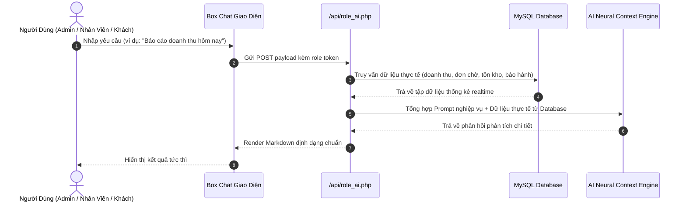
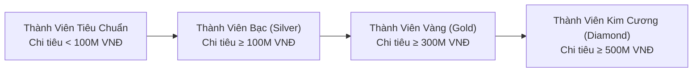
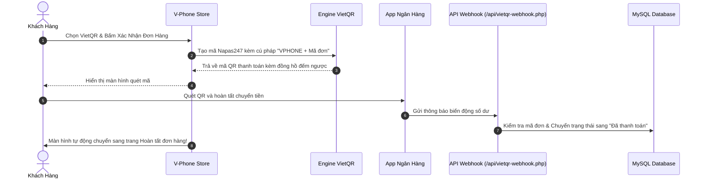

<div align="center">


# V-Phone Store

**Enterprise Flagship E-Commerce & Multi-Role Cyber AI Ecosystem**

*Hệ thống thương mại điện tử chuyên sâu thiết bị di động Flagship, tích hợp Trợ lý Trí tuệ Nhân tạo đa chuyên môn & Cổng thanh toán trực tuyến tự động 4.0 trên nền tảng PHP MVC.*

<br/>

[](https://php.net)
[](https://mysql.com)
[](https://github.com/luchuynh51003/vphone-store)
[](https://getbootstrap.com)
[](https://developer.mozilla.org)
[](https://vietqr.net)
[](LICENSE)

<br/>

[Overview](#overview) • [Core Features](#core-features) • [Multi-Role AI Engine](#multi-role-ai-engine) • [Membership System](#membership-tier-system) • [Fintech & Payment](#fintech--payment-integration) • [RBAC Matrix](#rbac-permission-matrix) • [Tech Stack](#technology-stack) • [Installation](#installation--setup) • [Demo Accounts](#demo-credentials) • [Authors](#authors--development-team) • [License](#license)

<br/>

<a href="https://skillicons.dev">
  
</a>

</div>

---

## Overview

**V-Phone Store** là giải pháp nền tảng thương mại điện tử toàn diện dành cho các chuỗi bán lẻ thiết bị di động cao cấp (Flagship Smartphones). Hệ thống được thiết kế theo mô hình **MVC (Model - View - Controller)** với PHP thuần hiện đại, tối ưu tốc độ phản hồi (<0.8s) và bảo mật PDO chống tấn công injection.

Điểm khác biệt của dự án là việc tích hợp **Hệ thống Trợ lý AI đa vai trò (Multi-Role AI Neural Assistant)** với 6 kịch bản nghiệp vụ độc lập, đi kèm cổng đối soát thanh toán tự động **VietQR Napas247** và **MoMo Sandbox API v2**.

> [!NOTE]
> Dự án được tối ưu hóa cho cả hai giao diện **Light Mode** và **Cyber Dark Mode**, xử lý triệt để tương phản màu sắc thẻ sản phẩm và viền ảnh trong môi trường thiếu sáng.

---

## Core Features

### 1. Storefront & Customer Experience
- **Live Search**: Tìm kiếm tức thì theo thời gian thực (real-time debouncing), hiển thị hình ảnh, giá bán và phiên bản dung lượng ngay trong thanh tìm kiếm.
- **Multi-Faceted Filtering**: Lọc sản phẩm đa chiều theo hãng (Apple, Samsung, Xiaomi, OPPO,...), phân khúc giá, bộ nhớ trong (ROM), RAM và các tính năng đặc thù (Màn hình gập, 5G, Camera AI).
- **Product Comparison Tool**: So sánh song song cấu hình chi tiết (màn hình, vi xử lý, camera trước/sau, dung lượng pin, trọng lượng và giá bán) giữa các dòng máy.
- **Trade-In Program**: Công cụ định giá máy cũ tự động theo ngoại hình và hiện trạng sử dụng, cấp voucher trợ giá lên đời Flagship mới.
- **Smart Shopping Cart**: Quản lý giỏ hàng theo session/tài khoản, tự động kiểm tra điều kiện áp dụng mã giảm giá theo ngưỡng đơn tối thiểu.
- **Multi-Step Checkout**: Sổ lưu nhiều địa chỉ nhận hàng, chọn phương thức vận chuyển và phương thức thanh toán linh hoạt.
- **Verified Purchase Reviews**: Hệ thống chỉ cho phép khách hàng đã mua và nhận máy thành công gửi đánh giá sao kèm hình ảnh unbox thực tế.
- **Omni-Channel Floating Hub**: Widget hỗ trợ gọi hotline, liên hệ Zalo và gửi biểu mẫu yêu cầu gọi lại (Callback Request).

---

## Multi-Role AI Engine

Khác với các chatbot thương mại điện tử thông thường, hệ thống AI của V-Phone Store phân bổ context và quyền hạn riêng biệt theo **6 vai trò nghiệp vụ**:

| Role Key | Chức Vụ Đại Diện | Đối Tượng Sử Dụng | Nhiệm Vụ & Năng Lực Cốt Lõi |
| :--- | :--- | :--- | :--- |
| `admin` | **Executive Admin AI** | Quản trị viên tối cao | Phân tích số liệu doanh thu hôm nay, tuần, tháng; dự báo xu hướng mua sắm; tư vấn kế hoạch nhập hàng Flagship |
| `sales` | **Sales Consultant AI** | Nhân viên bán hàng | Gợi ý sản phẩm thay thế theo ngân sách, kịch bản up-sell phụ kiện, tư vấn mã giảm giá đang kích hoạt |
| `warehouse` | **Warehouse AI** | Quản lý kho vận | Kiểm kê tồn kho theo phiên bản màu sắc/bộ nhớ, cảnh báo các mã máy có số lượng tồn kho $\le$ 5, tra cứu IMEI |
| `warranty` | **Tech & Care AI** | Kỹ thuật viên bảo hành | Hỗ trợ chẩn đoán mã lỗi phần cứng/màn hình, tra cứu thời hạn bảo hành qua IMEI, hướng dẫn quy trình 1 đổi 1 |
| `support` | **Support Desk AI** | Chăm sóc khách hàng | Kịch bản phản hồi khách hàng chuẩn 5 sao, giải quyết khiếu nại giao trễ, xử lý yêu cầu hoàn tiền |
| `customer` | **Cyber AI Khách Hàng**| Người mua sắm trực tuyến | Trợ lý tư vấn cấu hình 24/7, hướng dẫn thủ tục mua trả góp 0%, đề xuất dòng máy tối ưu theo ngân sách |



---

## Membership Tier System

Dịch vụ `MembershipService.php` điều khiển cơ chế phân hạng hội viên tự động dựa trên tổng chi tiêu tích lũy từ các đơn hàng thành công:



- **Thẻ hội viên số (Digital Member Card)**: Hiển thị thẻ VIP phong cách kim loại trong trang Profile cá nhân, đi kèm mã thẻ định danh và thanh tiến trình chi tiêu thăng hạng.
- **Đặc quyền VIP**:
  - Chiết khấu phần trăm trực tiếp trên giá trị mọi đơn hàng.
  - Bộ mã voucher ưu đãi độc quyền phát tự động theo từng cấp bậc hàng tháng.
  - Hỗ trợ kỹ thuật ưu tiên và quà tặng tri ân dịp sinh nhật.

---

## Fintech & Payment Integration

Hệ thống hỗ trợ 3 phương thức thanh toán an toàn, tự động hóa toàn bộ khâu đối soát:

1. **VietQR Napas247 (Dynamic QR Code)**:
   - Sinh mã QR động chứa chính xác số tài khoản ngân hàng, số tiền phải thanh toán và nội dung chuyển khoản duy nhất (`VPHONE + Mã đơn hàng`).
   - Webhook lắng nghe biến động số dư tức thì, tự động chuyển đơn sang trạng thái `Đã thanh toán` mà không cần xác nhận thủ công.
   - Hỗ trợ chế độ **Demo Simulator** kiểm thử thanh toán 1-click trong môi trường phát triển.

2. **MoMo Payment Gateway (API v2)**:
   - Kết nối cổng thanh toán quét mã MoMo Sandbox.
   - Xác thực giao dịch thông qua cơ chế IPN (Instant Payment Notification) với chữ ký số bảo mật `HMAC-SHA256`.

3. **Cash on Delivery (COD)**:
   - Phương thức thanh toán khi nhận hàng, kiểm tra máy trước khi thanh toán.



---

## RBAC Permission Matrix

Cơ chế phân quyền kiểm soát truy cập dựa trên vai trò (Role-Based Access Control) được quản lý qua `admin/includes/permissions.php`:

| Module Quản Trị | Permission Key | Super Admin | Quản Lý (Admin) | Bán Hàng (Sales) | Thủ Kho (Warehouse) | Kỹ Thuật (Warranty) | CSKH (Support) |
| :--- | :--- | :---: | :---: | :---: | :---: | :---: | :---: |
| **Quản lý Đơn hàng** | `orders` | Toàn quyền | Toàn quyền | Toàn quyền | Không | Không | Xem |
| **Quản lý Sản phẩm** | `products` | Toàn quyền | Toàn quyền | Xem | Xem | Không | Không |
| **Quản lý Kho & IMEI** | `inventory` | Toàn quyền | Toàn quyền | Không | Toàn quyền | Không | Không |
| **Bảo hành & Sửa chữa** | `warranties` | Toàn quyền | Toàn quyền | Không | Không | Toàn quyền | Xem |
| **Đánh giá & Phản hồi** | `reviews` | Toàn quyền | Toàn quyền | Toàn quyền | Không | Không | Toàn quyền |
| **Mã giảm giá Voucher** | `vouchers` | Toàn quyền | Toàn quyền | Toàn quyền | Không | Không | Không |
| **Tin tức & Bài viết** | `news` | Toàn quyền | Toàn quyền | Không | Không | Không | Không |
| **Hỗ trợ CSKH & Callback** | `support` | Toàn quyền | Toàn quyền | Không | Không | Không | Toàn quyền |
| **Trợ lý AI chuyên môn** | `ai_assistant` | Toàn quyền | Toàn quyền | Toàn quyền | Toàn quyền | Toàn quyền | Toàn quyền |
| **Quản lý Nhân sự** | `staff` | Toàn quyền | Không | Không | Không | Không | Không |
| **Đồng bộ Cơ sở dữ liệu** | `db_sync` | Toàn quyền | Không | Không | Không | Không | Không |

---

## Technology Stack

| Tầng Hệ Thống | Công Nghệ Sử Dụng | Ghi Chú Kỹ Thuật |
| :--- | :--- | :--- |
| **Core Backend** | PHP 8.x / PHP 7.4+ | Mô hình MVC hướng đối tượng, PDO Prepared Statements, Session Management |
| **Database** | MySQL 8.0+ / MariaDB 10.4+ | InnoDB Engine, quan hệ khóa ngoại (Foreign Keys), UTF-8 Unicode (`utf8mb4`) |
| **Frontend UI** | HTML5, CSS3, JavaScript ES6+ | Bootstrap 5.3, Font Awesome 6 Pro, Google Fonts (Plus Jakarta Sans) |
| **Theming** | CSS Variables, Custom Dark Mode | Chuyển đổi theme mượt mà, tối ưu hóa màu sắc cho thiết bị màn hình OLED |
| **Fintech API** | VietQR API, MoMo API v2 | Dynamic Napas247 QR, IPN Webhook Receiver, mã hóa bảo mật HMAC-SHA256 |
| **Auth & Security** | Google OAuth 2.0, OTP Mailer | Single Sign-On (SSO), xác thực email qua OTP, Bcrypt password hashing |
| **Tooling** | Git, Apache XAMPP, Postman | Database Sync Tool nạp xuất dữ liệu tự động giữa macOS và Windows |

---

## Project Structure

```plaintext
phone-store/
├── admin/                         # Hệ thống quản trị nội bộ
│   ├── ai_assistants.php          # Trung tâm điều hành Trợ lý AI theo chức vụ (AI Hub)
│   ├── db_sync.php                # Giao diện đồng bộ & sao lưu Database
│   ├── includes/                  # Thành phần giao diện chung (header, sidebar, footer, permissions)
│   ├── index.php                  # Dashboard tổng thể & báo cáo doanh thu
│   ├── inventory.php              # Quản lý kho hàng & kiểm kê IMEI
│   ├── news.php                   # Quản lý bài viết tin tức công nghệ
│   ├── orders.php                 # Quản trị đơn hàng, cập nhật trạng thái & in hóa đơn
│   ├── products.php               # Quản lý sản phẩm, thương hiệu & biến thể
│   ├── reviews.php                # Kiểm duyệt và phản hồi đánh giá khách hàng
│   ├── staff_dashboard.php        # Bàn làm việc phân quyền cho nhân viên cửa hàng
│   ├── staff.php                  # Quản lý hồ sơ nhân viên & ma trận phân quyền
│   ├── support.php                # Tiếp nhận callback & giải quyết khiếu nại
│   ├── users.php                  # Quản lý danh sách khách hàng & hạng hội viên
│   ├── vouchers.php               # Quản lý mã giảm giá
│   └── warranties.php             # Quản lý hồ sơ bảo hành thiết bị
├── api/                           # API Endpoints xử lý bất đồng bộ (AJAX & Webhooks)
│   ├── callback-request.php       # Tiếp nhận yêu cầu gọi lại từ khách hàng
│   ├── chatbot.php                # Engine Chatbot bán hàng Flagship 24/7
│   ├── momo-ipn.php               # Webhook IPN xử lý kết quả thanh toán MoMo
│   ├── notifications.php          # API lấy thông báo tài khoản theo thời gian thực
│   ├── role_ai.php                # Multi-Role AI Neural Assistant Engine (6 vai trò)
│   ├── search.php                 # API Live Search tìm kiếm nhanh sản phẩm
│   └── vietqr-webhook.php         # Webhook đối soát tự động thanh toán VietQR
├── app/                           # Lớp mã nguồn ứng dụng theo chuẩn MVC
│   ├── controllers/               # Các Controller điều hướng (Auth, Cart, Home, Order, Product, Profile, Review)
│   ├── models/                    # Lớp DAO truy xuất CSDL (Address, Article, Notification, Order, Product, Review, User, Voucher, Warranty)
│   ├── services/                  # Business Logic Services (MembershipService)
│   └── views/                     # Giao diện người dùng (home, product_detail, cart, checkout, compare, stores, warranty,...)
├── assets/                        # Tài nguyên tĩnh (css, js, images logo & sản phẩm Flagship)
├── config/                        # Cấu hình tập trung (database.php, google.php, momo.php, vietqr.php)
├── database/                      # CSDL & công cụ di trú (db_phone_store.sql, db_sync_tool.php)
├── scripts/                       # Shell scripts tự động hóa đồng bộ git/sync
├── index.php                      # Application Entry Point & Router
├── LICENSE                        # Giấy phép bản quyền MIT
└── README.md                      # Tài liệu hướng dẫn dự án
```

---

## Database Schema

Cơ sở dữ liệu `db_phone_store` gồm 13 bảng quan hệ:

| Bảng Dữ Liệu | Thực Thể Lưu Trữ | Vai Trò Chính |
| :--- | :--- | :--- |
| `users` | Tài khoản người dùng | Lưu trữ thông tin khách hàng, nhân viên, phân quyền (`permissions`), hạng VIP |
| `products` | Sản phẩm điện thoại | Lưu tên máy, hãng, giá niêm yết, giá khuyến mãi, màu sắc, thông số, tồn kho |
| `brands` | Thương hiệu sản xuất | Danh mục các hãng (Apple, Samsung, Xiaomi, OPPO, Google, Vivo, Asus, Sony) |
| `orders` | Đơn hàng | Thông tin đơn hàng, tổng tiền, phương thức thanh toán, trạng thái VietQR/MoMo |
| `order_details` | Chi tiết đơn hàng | Danh sách máy trong từng đơn, biến thể màu sắc, dung lượng và giá bán thời điểm mua |
| `vouchers` | Khuyến mãi | Quản lý mã giảm giá theo %, giá trị giảm tối đa, đơn hàng tối thiểu áp dụng |
| `warranty_claims` | Bảo hành | Quản lý phiếu bảo hành, tra cứu IMEI, triệu chứng hư hỏng và tiến độ sửa chữa |
| `product_reviews` | Đánh giá | Bình luận, xếp hạng số sao và hình ảnh đính kèm từ khách mua hàng thực tế |
| `user_addresses` | Sổ địa chỉ | Lưu nhiều địa chỉ nhận hàng của khách hàng |
| `user_notifications`| Thông báo | Quản lý thông báo trạng thái đơn hàng gửi đến người dùng |
| `articles` | Tin tức | Quản lý bài viết công nghệ, thủ thuật thiết bị |
| `callback_requests` | Yêu cầu tư vấn | Tiếp nhận số điện thoại và ghi chú khách hàng yêu cầu gọi lại |
| `password_resets` | Khôi phục mật khẩu | Quản lý mã OTP và thời hạn xác thực khôi phục mật khẩu |

---

## API Endpoints

| Method | Endpoint URL | Mục Đích | Tham Số Đầu Vào | Định Dạng Trả Về |
| :---: | :--- | :--- | :--- | :---: |
| `POST` | `/api/role_ai.php` | Xử lý hội thoại AI theo 6 vai trò | `message`, `role` | `application/json` |
| `POST` | `/api/chatbot.php` | Tư vấn bán hàng Storefront | `message` | `application/json` |
| `GET` | `/api/search.php` | Live Search sản phẩm | `q` (từ khóa tìm kiếm) | `application/json` |
| `POST` | `/api/vietqr-webhook.php` | Webhook đối soát VietQR | Payload từ dịch vụ ngân hàng | `application/json` |
| `POST` | `/api/momo-ipn.php` | Webhook IPN từ cổng MoMo | MoMo Signature & Payment Data | `application/json` |
| `POST` | `/api/callback-request.php`| Tiếp nhận yêu cầu gọi lại | `phone`, `fullname`, `note` | `application/json` |
| `GET` | `/api/notifications.php` | Lấy thông báo theo session | Phiên đăng nhập người dùng | `application/json` |

---

## Installation & Setup

### Yêu Cầu Môi Trường
- Máy chủ web cục bộ: **XAMPP**, **Laragon**, **WampServer** hoặc **LAMP Stack**.
- Phiên bản PHP: **PHP 7.4** trở lên (khuyến nghị **PHP 8.1 - 8.2**).
- Cơ sở dữ liệu: **MySQL 5.7+** hoặc **MariaDB 10.4+**.
- Các tiện ích mở rộng PHP bắt buộc: `pdo_mysql`, `curl`, `mbstring`, `openssl`, `fileinfo`.

### Các Bước Cài Đặt

```bash
# 1. Chuyển vào thư mục web root của máy chủ web
cd /Applications/XAMPP/xamppfiles/htdocs/     # macOS XAMPP
# hoặc: cd C:/xampp/htdocs/                   # Windows XAMPP

# 2. Clone repository từ GitHub
git clone https://github.com/luchuynh51003/vphone-store.git phone-store
cd phone-store
```

```bash
# 3. Tạo CSDL trong MySQL và nạp dữ liệu mẫu
mysql -u root -p -e "CREATE DATABASE db_phone_store CHARACTER SET utf8mb4 COLLATE utf8mb4_unicode_ci;"
mysql -u root -p db_phone_store < database/db_phone_store.sql
```

*(Hoặc mở `http://localhost/phpmyadmin`, tạo CSDL `db_phone_store` và Import file `database/db_phone_store.sql`)*

```bash
# 4. Kiểm tra cấu hình kết nối tại config/database.php
# $host = 'localhost';
# $dbname = 'db_phone_store';
# $username = 'root';
# $password = '';
```

```bash
# 5. Khởi động Apache & MySQL trong XAMPP, mở trình duyệt:
# - Cửa hàng: http://localhost/phone-store/
# - Quản trị: http://localhost/phone-store/admin/
```

---

## Demo Credentials

Tất cả các tài khoản thử nghiệm đều có mật khẩu mặc định: `123456`

| Quyền Hạn | Email Đăng Nhập | Mật Khẩu | Quyền Hạn Thực Tế |
| :--- | :--- | :---: | :--- |
| **Super Admin** | `admin@vphone.vn` | `123456` | Toàn quyền kiểm soát hệ thống, thống kê doanh thu, phân quyền nhân sự |
| **Quản Lý Cấp Cao** | `hieu@vphone.vn` | `123456` | Quản trị danh mục máy, đơn hàng, điều phối bảo hành |
| **Nhân Viên Bán Hàng** | `luc@vphone.vn` | `123456` | Truy cập bàn làm việc nhân viên, duyệt đơn, tra cứu bảo hành, dùng Trợ lý AI |
| **Khách Hàng Mẫu** | `ongnoitapchoi2003@gmail.com` | `123456` | Trải nghiệm mua sắm, tích lũy điểm VIP, kiểm tra bảo hành |

---

## Troubleshooting

- **Xung đột cổng MySQL (3306 vs 3307)**: Mở `config/database.php` và cập nhật `$host = 'localhost:3307';`.
- **Dung lượng file SQL import lớn**: Tăng thông số `upload_max_filesize = 64M` và `post_max_size = 64M` trong file `php.ini`.
- **Quyền ghi thư mục upload trên macOS / Linux**:
  ```bash
  chmod -R 777 assets/images/users/
  chmod -R 777 database/
  ```

---

## Authors & Development Team

Dự án **V-Phone Store** được nghiên cứu và đồng phát triển trong khuôn khổ Đồ án Chuyên ngành bởi nhóm tác giả:

| Thành Viên | Vai Trò & Phụ Trách Nghiệp Vụ | Email Liên Hệ | Kênh Liên Kết |
| :--- | :--- | :--- | :--- |
| **Huỳnh Bá Lực** | Co-Founder & Lead Developer (Kiến trúc MVC, Cổng thanh toán VietQR & MoMo, UI/UX Cyber Dark Mode) | [beluc5102003@gmail.com](mailto:beluc5102003@gmail.com) | [@luchuynh51003](https://github.com/luchuynh51003) |
| **Võ Minh Hiếu** | Co-Founder & Core Developer (Thiết kế CSDL Flagship, Module Sản phẩm & Quản trị hệ thống) | [vmh1642006@gmail.com](mailto:vmh1642006@gmail.com) | [hieu@vphone.vn](mailto:hieu@vphone.vn) |

---

## License

Phát hành theo giấy phép [MIT License](LICENSE).  
Bản quyền © 2026 thuộc về **Huỳnh Bá Lực** & **Võ Minh Hiếu**. Bạn được tự do tham khảo, học tập và phát triển phục vụ mục đích học thuật và phi thương mại.

---

<div align="center">
  <sub>Được phát triển với niềm đam mê công nghệ Flagship & Trí tuệ Nhân tạo thế hệ mới.</sub>
</div>
